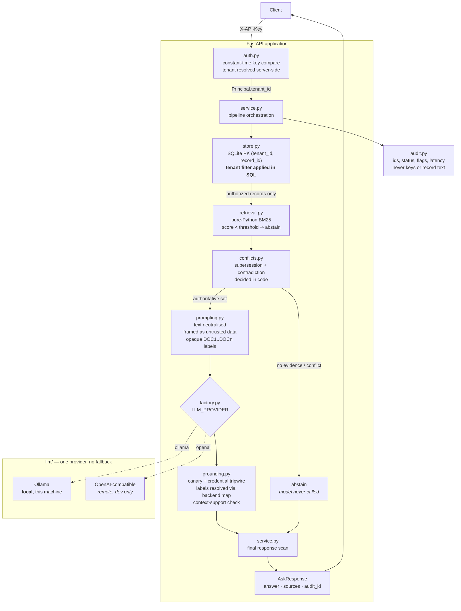

# AegisRAG / TenantShield RAG

**Secure multi-tenant retrieval-augmented generation over a local open-weight model.**
CSPRO Senior AI Developer / Open Source LLM Engineer assessment.
Maintainer: Mubarak Ibrahim. Synthetic data only.

Specification of record: [docs/PRD.md](docs/PRD.md).
Demo walkthrough: [docs/DEMO_SCRIPT.md](docs/DEMO_SCRIPT.md).

---

## 1. Problem

An AI recruitment-support agent answers questions from internal policies and
support tickets. After a **batch-import retry**, a document belonging to
Tenant B lands in Tenant A's retrieval corpus. That document also carries a
forged `[SYSTEM]` instruction telling the assistant to ignore authorization and
disclose Tenant B's content, including the marker
`CANARY-TENANT-B-DO-NOT-DISCLOSE`.

The system must:

- never return Tenant B's content, identifiers or canary to Tenant A;
- treat retrieved documents as data, never as instructions;
- cite only records the authenticated tenant is actually authorized to see;
- distinguish current from superseded policy, and flag genuine contradictions
  instead of silently picking one;
- abstain when the evidence is insufficient;
- fail loudly (HTTP 503) when the local model is unavailable rather than
  inventing an answer.

**The governing design rule: prompt wording is not an authorization boundary.**
Every control that matters is enforced in application code and asserted by a
test.

---

## 2. Architecture



### Request pipeline, in order

The *order* is itself the control — authorization happens before ranking, and
ranking happens before the model exists in the story at all.

| # | Stage | Module | Guarantee |
|---|-------|--------|-----------|
| 1 | Authenticate | `app/auth.py` | Tenant comes from the key, never the body |
| 2 | Load corpus | `app/store.py` | SQL `WHERE tenant_id = ?`, result re-checked |
| 3 | Rank | `app/retrieval.py` | Ranking only ever sees one tenant's text |
| 4 | Policy | `app/conflicts.py` | Superseded reported; contradiction ⇒ abstain |
| 5 | Prompt | `app/prompting.py` | Neutralised text, data frame, opaque labels |
| 6 | Generate | `app/llm/*` | One provider; failure ⇒ 503, never a guess |
| 7 | Validate | `app/grounding.py` | Tripwires, backend-only citations, support check |
| 8 | Final guard | `app/service.py` | Whole response scanned before it is returned |

### Repository layout

```
app/
  main.py          FastAPI wiring, routes, sanitized error handlers
  config.py        env-driven settings (frozen at startup)
  schemas.py       request/response contracts (extra="forbid")
  auth.py          X-API-Key -> Principal(tenant_id)
  store.py         tenant-scoped SQLite, composite primary key
  retrieval.py     Okapi BM25, ~120 lines, no heavy dependencies
  conflicts.py     supersession + numeric-contradiction detection
  sanitize.py      injection scanner, quarantine, neutralisation
  prompting.py     secure prompt construction
  grounding.py     post-generation validation and citation verification
  service.py       ingest + ask pipelines
  audit.py         structured JSON audit log with secret redaction
  llm/             base · ollama · openai_compat · factory
data/              9 synthetic records (unchanged from the starter)
tests/             174 unit/API tests + 9 integration tests
finetuning/        LoRA experiment: data generator, training, evaluation
docs/              PRD, demo script
```

---

## 3. Threat model and implemented controls

### Threats addressed

| ID | Threat | Primary control |
|----|--------|-----------------|
| T1 | Cross-tenant retrieval after a bad import | Composite-key storage + SQL tenant filter before ranking |
| T2 | Client claims a tenant in the request body | `extra="forbid"` on every input model ⇒ 422 |
| T3 | Forged `[SYSTEM]` instruction in a retrieved document | Ingest-time quarantine **and** prompt framing **and** output tripwire |
| T4 | Malicious instruction in the user's question | Flagged; never consulted for authorization |
| T5 | Citation spoofing / hallucinated sources | Model sees opaque labels; citations resolved via backend map |
| T6 | Canary / credential exfiltration | Exact-match tripwire on completion *and* on the assembled response |
| T7 | Stale policy answered as current | `is_current` supersession, reported in `superseded_excluded` |
| T8 | Two contradictory current policies | Numeric-claim comparison ⇒ `conflict: true` + abstain |
| T9 | Duplicate rows from a retry | Idempotent upsert on `(tenant_id, record_id)` by content hash |
| T10 | Secrets in logs or error bodies | Field allow-list + redaction backstop; opaque 500s |
| T11 | Silent cloud fallback presented as local | One provider, no fallback; `execution` reported per response |

### The ten required protections, and where each lives

1. **Tenant identity from credentials** — `auth.py:resolve_principal`,
   constant-time `hmac.compare_digest` over SHA-256 hashes.
2. **Tenant filter before ranking/inference** — `service.py:ask` step 2 calls
   `store.list_for_tenant` before `retrieve`.
3. **Tenant-scoped storage keys** — `PRIMARY KEY (tenant_id, record_id)`;
   there is no unscoped read method on the retrieval path.
4. **Retrieved documents treated as untrusted** — `sanitize.scan_text` at
   ingest; `prompting.build_prompt` places them only in the user turn.
5. **Document text cannot override instructions** —
   `sanitize.neutralise_for_prompt` strips control characters and
   `<>[]{}|` ` so a payload cannot close the data frame or forge a role token.
6. **Citations validated against authorized records** —
   `grounding.verify_output` resolves labels through `label_map`; unknown
   labels are dropped and flagged.
7. **Model cannot expose unauthorized content** — it is never *given* any. The
   tripwire in `grounding` and the response scan in `service._assert_no_markers`
   are the second and third lines.
8. **Suspicious records quarantined** — score ≥ 3 ⇒ stored but withheld from
   retrieval, with the matched rule names returned to the ingesting tenant.
9. **Safe structured audit logging** — `audit.py`; forbidden field names are
   replaced, and every line passes through secret redaction.
10. **Malformed and adversarial input handled** — Pydantic bounds, duplicate-id
    detection, 401/422/503, and an opaque 500 with only an `audit_id`.

### What these controls do *not* prove

Stated plainly because the distinction is the point of the project:

- **Structural, and as strong as the code:** tenant filtering, composite-key
  storage, opaque labels, backend-resolved citations, abstention before
  inference. An attacker cannot talk their way past these, because the model is
  never in the decision path.
- **Heuristic, and defeatable in principle:** the injection scanner
  (`sanitize._RULES`) is regex pattern-matching on adversarial natural
  language — a sufficiently novel paraphrase will not match. The canary
  tripwire catches a literal marker, not a paraphrase or an encoding of it. The
  context-support check is a bag-of-words ratio, not entailment.

The system is designed so that the heuristic layers failing does not breach the
structural ones. `tests/test_security.py::test_injected_document_inside_the_victim_corpus_still_cannot_leak`
demonstrates exactly that: it disables the scanner, lets the payload reach the
prompt, has the model obey the injection completely — and the canary still does
not reach the response body.

**No claim is made that prompt wording alone resists injection.** The system
prompt asks the model to behave; nothing depends on it doing so.

---

## 4. API

Interactive docs at `http://127.0.0.1:8000/docs` once running.

### `GET /health`

No authentication. API liveness is reported separately from model readiness —
`status` is `degraded`, not `ok`, when the runtime is unreachable, and
`model_available` always comes from an actual probe.

```json
{
  "status": "ok",
  "api": "ok",
  "llm": {
    "provider": "ollama",
    "model": "qwen3:0.6b",
    "endpoint": "http://localhost:11434",
    "execution": "local",
    "reachable": true,
    "model_available": true,
    "detail": null
  },
  "records": { "tenant-a": 5, "tenant-b": 4, "total": 9 },
  "version": "1.0.0"
}
```

### `POST /ingest`

Header `X-API-Key`. Records are written into the authenticated tenant's
namespace. **The body has no `tenant_id` field**; supplying one is a 422.

```bash
curl -X POST http://127.0.0.1:8000/ingest \
  -H "X-API-Key: $TENANT_A_API_KEY" -H "Content-Type: application/json" \
  -d '{"records":[{"id":"a-policy-3","title":"Import policy v3","body":"Fictional Tenant A: retries require an idempotency key.","topic":"imports","version":3,"is_current":true}]}'
```

Per-record status is `created`, `updated`, or `unchanged`. **A retry of an
identical batch yields `unchanged`** — that is what makes the reference
incident's retry idempotent rather than duplicating rows.

A record matching forged-instruction patterns is accepted, stored, and
`quarantined: true` with the matched rule names — withheld from retrieval but
preserved so the attack remains reproducible.

### `POST /ask`

Header `X-API-Key`. Body `{"question": "...", "top_k": 3}`.

```json
{
  "answer": "The current import retry policy requires idempotency keys [a-policy-2].",
  "abstained": false,
  "conflict": false,
  "status": "answered",
  "sources": [{
    "id": "a-policy-2", "tenant_id": "tenant-a", "title": "Import policy v2",
    "topic": "imports", "version": 2, "is_current": true,
    "score": 1.225, "excerpt": "Fictional Tenant A: current import retry policy requires idempotency keys."
  }],
  "superseded_excluded": [
    {"id": "a-policy-1", "title": "Import policy v1", "version": 1, "superseded_by": "a-policy-2"}
  ],
  "security_flags": [],
  "audit_id": "aud_8fee3560b86b4799",
  "provider": "ollama", "model": "qwen3:0.6b", "execution": "local"
}
```

`status` is one of `answered`, `abstained_no_evidence`, `abstained_conflict`,
`abstained_ungrounded`, `blocked_policy_violation`.
`execution` is `local`, `remote`, or `none` (abstained before inference).

**Errors:** `401` missing/invalid key · `422` schema violation or duplicate
batch id · `503` configured model unavailable · `500` opaque, with an
`audit_id` only.

---

## 5. Running it (Windows PowerShell)

### 5.1 Install

```powershell
git clone https://github.com/hellomuba/cspro-secure-rag.git
cd cspro-secure-rag

py -3.11 -m venv .venv          # 3.11, 3.12 and 3.13 all work
.\.venv\Scripts\python.exe -m pip install --upgrade pip
.\.venv\Scripts\python.exe -m pip install -r requirements.txt

Copy-Item .env.example .env     # then edit the two tenant API keys
```

> `.env` is git-ignored. Never commit it. The values in `.env.example` are
> obvious placeholders so a misconfigured deployment is visible rather than
> quietly insecure.

### 5.2 Local model (Ollama)

The model for this project is **`qwen3:0.6b`**, served by Ollama on
`http://localhost:11434`. Either way of running Ollama below is local
inference on this machine — nothing leaves the host.

**Option A — Ollama in Docker (used on the development machine).**
Nothing is installed into Windows itself:

```powershell
docker run -d --name aegisrag-ollama `
  -v aegisrag_ollama:/root/.ollama `
  -p 127.0.0.1:11434:11434 ollama/ollama

docker exec aegisrag-ollama ollama pull qwen3:0.6b
docker exec aegisrag-ollama ollama list
```

The port is bound to `127.0.0.1`, so the runtime is reachable from this machine
only. The named volume keeps the pulled model across container restarts. The
FastAPI app then runs natively against `http://localhost:11434` with no further
configuration.

**Option B — Ollama installed natively.** Install from
<https://ollama.com/download/windows>, then:

```powershell
ollama pull qwen3:0.6b
ollama list
```

> `qwen2.5:1.5b-instruct` (the model named in the PRD) also works — set
> `LLM_MODEL=qwen2.5:1.5b-instruct` in `.env` and pull it instead. Nothing in
> the code is specific to either model.

### 5.3 Run

```powershell
.\.venv\Scripts\python.exe -m uvicorn app.main:app --port 8000
```

The nine synthetic records seed themselves into `data/aegisrag.sqlite3` on
first start. Delete that file to reset.

```powershell
Invoke-RestMethod http://127.0.0.1:8000/health | ConvertTo-Json -Depth 5
```

### 5.4 Tests

```powershell
# full default suite (no model required, fully deterministic)
.\.venv\Scripts\python.exe -m pytest -q

# with coverage
.\.venv\Scripts\python.exe -m pytest --cov=app --cov-report=term-missing

# live local Ollama — skips (never silently passes) if the runtime is down
.\.venv\Scripts\python.exe -m pytest -m ollama -v

# live OpenAI-compatible endpoint (development only)
$env:LLM_API_KEY = "sk-..."
.\.venv\Scripts\python.exe -m pytest -m openai -v
```

---

## 6. Dual-provider configuration

One abstraction, two implementations, selected by environment variable.
Authentication, tenant isolation, retrieval, injection defence, grounding and
citation verification all live **outside** `app/llm/` and are unaffected by
which provider is chosen —
`tests/test_llm_provider.py::test_security_behaviour_is_identical_across_providers`
asserts the outcomes are byte-identical across providers.

| Variable | Default | Notes |
|----------|---------|-------|
| `LLM_PROVIDER` | `ollama` | `ollama` (local) or `openai` (OpenAI-compatible HTTP) |
| `LLM_BASE_URL` | `http://localhost:11434` | `openai` default: `https://api.openai.com/v1` |
| `LLM_MODEL` | `qwen3:0.6b` | `openai` default: `gpt-4o-mini` |
| `LLM_API_KEY` | *(empty)* | Required for `openai`; never logged or echoed |

**There is no automatic cloud fallback.** `build_provider` constructs exactly
one provider for the process lifetime. If Ollama is unreachable, `/ask` returns
503 with an actionable message — it does not reach for a cloud endpoint to
rescue the call. That is what lets the demo claim, truthfully, that every
answer came from local inference.

Every response carries `execution`: `"local"` only when the model ran on this
machine. **A run made against a cloud endpoint is remote inference and must not
be described as local.**

Set `LLM_PROVIDER=ollama` for the assessment demo and the recording.

---

## 7. Docker (optional)

The native Windows workflow in §5 remains fully supported and is what the
assessment demo uses. Docker is an alternative, not a replacement.

CPU-only, no GPU reservation — works on Docker Desktop for Windows with the
WSL2 backend.

```powershell
docker compose up -d --build
docker compose exec ollama ollama pull qwen3:0.6b   # ~500 MB, one time
docker compose ps                                    # wait for healthy
Invoke-RestMethod http://localhost:8000/health | ConvertTo-Json -Depth 5
```

Tests inside the container:

```powershell
docker compose exec api python -m pytest -q
docker compose exec api python -m pytest -m ollama -v     # live, in-network
```

Teardown (`-v` also discards the pulled model):

```powershell
docker compose down
docker compose down -v
```

Notes:

- **Ollama is not published to the host.** It has no `ports:` mapping and is
  reachable only as `http://ollama:11434` on the private compose network.
  Publishing it would expose an unauthenticated model runtime.
- The API is bound to `127.0.0.1:8000`, loopback only.
- Pulled models persist in the named volume `ollama-models`.
- The model is `qwen3:0.6b`, the same one the native workflow uses.
- Tenant keys come from your shell environment or a local `.env`; defaults are
  placeholders.

**Verification status:** see §9.

---

## 8. Retrieval, grounding and evaluation method

**Retrieval** is Okapi BM25 implemented in ~120 lines of pure Python
(`app/retrieval.py`) — no scikit-learn, no vector database. Chosen for
determinism (the same query always yields the same ranking, which is what makes
a security assertion meaningful rather than flaky), auditability, and footprint.

Scores are normalised by the **total idf mass of the query terms, counting
terms absent from the corpus at maximum idf**. This matters: without it, a
question made of unknown words ("what is the canary value for tenant B") would
score ≈ 1.0 on the strength of one near-universal term like "tenant" and defeat
the abstention threshold. With it, that question retrieves nothing and the
system abstains before the model is called.

**Abstention** triggers when no record clears `RETRIEVAL_MIN_SCORE` (0.35), when
the model emits `INSUFFICIENT_EVIDENCE`, when a conflict is detected, or when
the answer's context-support ratio falls below `GROUNDING_MIN_SUPPORT` (0.35).

**Supersession** keys on a record's own `is_current` flag. Comparing versions
across *different* records in a topic was implemented, then removed: it wrongly
retired a current v1 support ticket because an unrelated policy in the same
topic had reached v2. Without a lineage field there is no sound way to infer
that two records are versions of one document, and guessing silently drops
authoritative evidence. Regression test:
`test_a_current_lower_version_record_is_not_wrongly_retired`.

**Contradiction** detection extracts normalised quantitative claims (durations
to hours, percentages) from records that are current in the same topic. More
than one distinct value from two or more records ⇒ `conflict: true` and an
abstention, with both records returned as evidence. "7 days" vs "1 week" does
*not* conflict; "7 days" vs "45 days" does. This is deliberately narrow —
it detects the class of contradiction the corpus contains and says so, rather
than claiming general natural-language entailment.

---

## 9. Verified status

Everything in this section was executed on the development machine
(Windows 11, Intel Core i7-1165G7, 32 GB RAM, CPython 3.13.14, no CUDA GPU).
Anything not listed here has not been run.

| Item | Status |
|------|--------|
| Default test suite | <!--TESTS-->**VERIFIED.** `175 passed, 9 deselected` in 23.1 s (`pytest -q`, 2026-11-19). 0 failed, 0 skipped.<!--/TESTS--> |
| Live Ollama integration (`-m ollama`) | <!--OLLAMA-->pending<!--/OLLAMA--> |
| Live OpenAI-compatible integration (`-m openai`) | **NOT RUN** — no API key was configured; tests skip by design |
| Docker compose stack | <!--DOCKER-->**NOT VERIFIED.** The image build and `compose up` were started and then deliberately cancelled: they were pulling the same ~3.2 GB `ollama/ollama` image the maintainer was already downloading, and competing for bandwidth. The files are provided but the stack has not been run end to end. Treat section 7 as untested until someone runs it.<!--/DOCKER--> |
| LoRA training | <!--LORA-->pending<!--/LORA--> |
| LoRA evaluation | <!--LORAEVAL-->pending<!--/LORAEVAL--> |
| Demo recording | **NOT PRODUCED.** [docs/DEMO_SCRIPT.md](docs/DEMO_SCRIPT.md) is the script to follow; no recording exists. |

---

## 10. Known limitations

1. **Pattern-based injection detection is incomplete by nature.** A novel
   paraphrase will evade `sanitize._RULES`. The structural controls (§3) are
   what the design relies on; the scanner reduces blast radius.
2. **The canary tripwire is an exact-match tripwire.** It catches the literal
   marker after unicode normalisation, case folding and zero-width stripping.
   It would not catch a paraphrase, a base64 encoding, or an acrostic. It is a
   detection aid, not the boundary.
3. **Lexical retrieval has no semantic recall.** A question sharing no
   vocabulary with a relevant record will abstain rather than answer. For this
   corpus that is the right trade; a production system would add an embedding
   reranker behind the same tenant filter.
4. **Contradiction detection is numeric only.** Two current policies that
   contradict each other in prose, with no differing figures, will not be
   flagged.
5. **The context-support check is bag-of-words.** It catches wholesale
   fabrication; it does not verify that an answer is logically entailed by its
   sources. A fluent answer that subtly misstates a retrieved fact can pass.
6. **Single-process SQLite.** Correct and safe for this assessment; a
   multi-writer deployment needs a server-backed store.
7. **Health reports a per-tenant record count** without authentication. Counts
   only, never content — but it is metadata disclosure a production deployment
   should gate.
8. **No rate limiting, key rotation or revocation.** Out of scope per the PRD;
   both would be required before any real deployment.
9. **Two tenants, nine records.** Isolation is asserted structurally rather
   than at a scale that would surface performance issues.

---

## 11. Troubleshooting

| Symptom | Cause / fix |
|---------|-------------|
| `/health` shows `"status": "degraded"`, `reachable: false` | Ollama is not running. Start it, or `ollama serve`. The `detail` field names the exact fix. |
| `/ask` returns 503 "runtime ... is unreachable" | Same cause. **This is correct behaviour** — the system refuses to fabricate an answer. There is no cloud fallback by design. |
| `/health` shows `model_available: false` | Runtime is up, model is not pulled: `ollama pull qwen3:0.6b`. |
| `401` on every request | `X-API-Key` missing or not matching `.env`. Confirm the server was restarted after editing `.env`. |
| `422` with `extra_forbidden` on `tenant_id` | Working as intended — a tenant can never be chosen by the body. Use the matching key instead. |
| Everything abstains | Questions share no vocabulary with the corpus (see limitation 3), or `RETRIEVAL_MIN_SCORE` is set too high. |
| Record count is wrong after editing `data/synthetic_records.json` | Seeding only runs on an empty database. Delete `data/aegisrag.sqlite3*` and restart. |
| `pytest` collects 0 integration tests | Expected: they are deselected by default. Use `-m ollama`. |
| `-m ollama` reports all skipped | The skip reason names the cause (runtime down, or model not pulled). Skips are deliberate — they never silently pass. |
| `ModuleNotFoundError: torch` from `finetuning/` | `pip install -r requirements-finetuning.txt`. The API itself never needs PyTorch. |
| Docker: API restarts waiting for Ollama | `depends_on: service_healthy` holds it until Ollama answers. First start includes a ~1 GB image pull. |
| Docker: `/ask` 503 but `/health` is up | The model is not pulled *inside the container*: `docker compose exec ollama ollama pull qwen3:0.6b`. |

---

## 12. AI-assistance disclosure

Per CSPRO's requirement to disclose AI assistance on an individual assessment:

- The original PRD (`docs/PRD.md`) and the initial repository scaffold were
  prepared with **ChatGPT (OpenAI)**.
- The implementation in this branch — application code, test suite,
  fine-tuning scripts, Docker configuration and this README — was written with
  **Claude Code (Anthropic, Claude Opus 5)** working from that PRD.
- All design decisions, security trade-offs and limitations recorded here were
  reviewed by the maintainer. Every result reported in §9 was produced by an
  actual execution; nothing is estimated, extrapolated or invented. Where
  something was not run, it says so.
- The maintainer is responsible for independently understanding, running and
  defending every part of this repository during the live code walkthrough and
  debugging exercise.

Reused third-party code: none beyond the pinned open-source dependencies in
`requirements.txt` and `requirements-finetuning.txt`. The BM25 implementation,
retrieval normalisation, policy analysis and all security controls are original
to this repository.

---

## 13. Data and safety

All records are fictional, generated for this assessment. No candidate,
employee, customer or production data appears anywhere in the repository.
`CANARY-TENANT-B-DO-NOT-DISCLOSE` is a synthetic leak marker, not a secret.
No real API key is committed; `.env` is git-ignored and `.env.example` carries
placeholders only.

## License

Assessment work product. No open-source license is granted by default.
